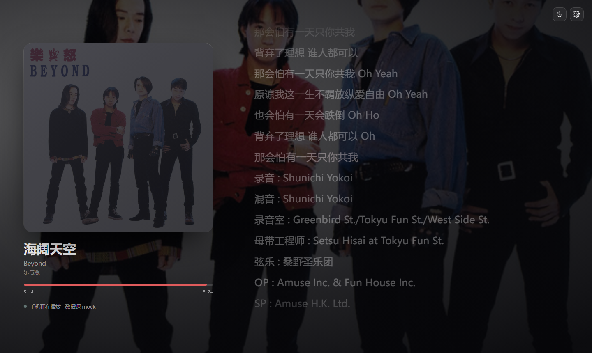
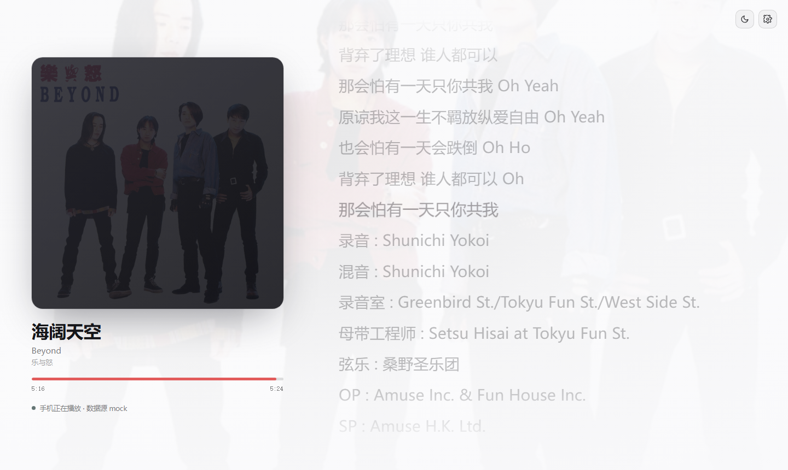

# NCM NowPlaying · phone NetEase Cloud Music → live lyrics on your PC

**English** | [简体中文](README.md)

Play music in NetEase Cloud Music on an Android phone or tablet, and see **cover art + live lyrics +
progress** on your PC in real time.

Two ways to display it — use either or both:

| Display | What it does |
|---|---|
| **BetterLyrics** | Masquerades the phone's playback as a Windows media session; BetterLyrics picks it up and renders it with its own lyric engine (word-by-word lyrics, glow effects, everything). See [Option C](#option-c-display-with-betterlyrics-or-any-smtc-based-desktop-lyrics-app) |
| **Built-in web page** | This project ships a browser display page, zero config, works on a second monitor or a tablet. See [Connecting a real phone](#connecting-a-real-phone) |

The desktop side is a **zero-dependency** Node service — Node 18+ is all you need, no `npm install`.





---

## How it works

```
Android phone (NetEase Cloud Music)
   └─ MediaSession carries title / artist / album / position
        │
        ├─ Option A: poll `dumpsys media_session` over wireless adb   ← nothing to install, recommended
        └─ Option B: HTTP push to /api/push                          ← your own app / Tasker / MacroDroid
             │
             ▼
      PC bridge service (Node)
        ├─ parses playback state, extrapolates "live" position from speed/updated
        ├─ matches title+artist against NetEase → cover art, timed LRC
        ├─ broadcasts over WebSocket to the browser
        └─ GET /api/nowplaying serves a condensed state
             │
             ├─────────────────────────┐
             ▼                         ▼
      browser display page      Option C: SMTC bridge
      http://localhost:8787     (smtc/smtc-bridge.ps1)
        ├─ cover + blurred bg          publishes state as a Windows media session
        ├─ current line highlighted    "NCMPhoneBridge"
        └─ progress, play state            │
                                           ▼
                                    BetterLyrics / any app
                                    that reads SMTC
                                    (own lyric engine,
                                    word-by-word support)
```

A few design decisions worth explaining:

- **Cover art and lyrics don't come from the phone — they come from NetEase.** A phone's MediaSession
  usually has no cover bitmap, but the title and artist it provides are enough to find the same song
  on NetEase, which yields a high-resolution cover and timed LRC. That makes both the lyric quality
  and the end-to-end experience noticeably better.
- **Progress is extrapolated, not polled.** The `position` inside `dumpsys` only refreshes when the
  app reports it, so reading it directly leaves it stuck. The parser therefore records
  `position + speed + updated` (milliseconds since boot) as an **anchor**, and the browser
  extrapolates from its local clock, combined with one NTP-style round trip (`ping`/`pong` to
  estimate clock offset). That keeps line scrolling smooth even at 60 fps.
- **It doesn't rely on the ordering of `position` fields, nor on Bundle field ordering.**
  `dumpsys` flattens metadata into `description=A, B, C`, and Bundle iteration order is not
  guaranteed across Android versions — so the matcher takes **the best candidate across all strings**
  for each field and adds a duration check, instead of assuming "first is title, second is artist".
- **The WebSocket implementation is hand-written.** To keep the project dependency-free, `src/ws.js`
  implements the RFC 6455 handshake, fragmentation, masked decoding, and ping/pong. If you would
  rather use the `ws` package, replacing that single file is enough.

---

## Quick start

### See it working first (no phone needed)

1. Install [Node.js](https://nodejs.org/) 18 or newer
2. Double-click `demo.bat`

Open <http://localhost:8787> and a virtual playlist starts playing, with real cover art and real
lyrics — it goes through exactly the same pipeline as a real device.

### Connecting a real phone

Two paths, pick one.

**① Phone app (recommended, no adb)** — easiest if you have `ncm-phone-bridge` installed:

| Step | What to do |
|---|---|
| 1 | In the phone app, tap "Start service" and note the address on screen |
| 2 | Put that address into `phoneUrl` in `config.json`, then double-click `start.bat` |

Details: [connect the phone app directly](#the-easiest-setup-connect-the-phone-app-directly-no-adb-at-all).

**② Wireless adb** — if you don't want to install anything on the phone:

| Step | What to do | Who does it |
|---|---|---|
| 1 | Phone: enable "Developer options → Wireless debugging" | You (only you can) |
| 2 | Double-click `setup-adb.bat`, enter the pairing port / pairing code / debugging port | You type three numbers, the script does the rest |

Once pairing succeeds, `setup-adb.bat` **automatically** starts both the service and the SMTC bridge
(two new windows), so you don't need to run `start.bat` and `smtc-bridge.bat` yourself.

`setup-adb.bat` **actually reads the phone's playback state once and tells you whether it worked** —
no guessing. Details: [Option A](#option-a-wireless-adb-nothing-to-install-on-the-phone).

If you would rather not enable developer options, see
[Option B (HTTP push)](#option-b-http-push-no-developer-options).

---

## The easiest setup: connect the phone app directly (no adb at all)

If you already installed `ncm-phone-bridge` on the phone (the Kotlin project next to this one, built
as an APK), this is the path to take: the phone reads its own playback state and prepares the cover
and lyrics itself; the PC only displays them. **No adb anywhere, and no developer options on the
phone.**

### 1. On the phone

1. Install the app and follow the prompt to enable **notification access**
2. Tap "Start service" and note the address on screen, e.g. `http://192.168.1.23:8787`

### 2. On the PC

Put the address into `config.json`:

```json
"phoneUrl": "http://192.168.1.23:8787"
```

Then double-click `start.bat`. The startup log prints:

```
数据源：手机 App（http://192.168.1.23:8787）— 无需 adb
```

> Once `phoneUrl` is set, the service **stops starting adb polling** (so you won't see it endlessly
> trying to reconnect to a phone). To go back to adb, clear `phoneUrl`.

### 3. Tablet / second monitor

Point the tablet's browser **directly at the phone's address** — data does not pass through the PC:

```
http://192.168.1.23:8787
```

### 4. Displaying it in BetterLyrics on the PC

Double-click `smtc-bridge.bat` as before. It reads local port 8787, and port 8787 is now showing the
phone app's content, so BetterLyrics gains an extra playback source — see
[Option C](#option-c-display-with-betterlyrics-or-any-smtc-based-desktop-lyrics-app).

### How the data lines up

The PC pulls the phone's state every 1.5 seconds. The phone reports positions against **its own
clock**; the PC estimates the offset between the two devices from the midpoint of the request round
trip and converts to local time — so even if the two clocks are minutes apart, the lyrics stay in
sync.

The PC **does not re-match lyrics**. It uses whatever the phone already matched (the same data feeds
both the web page and BetterLyrics), which keeps both displays identical and avoids an extra network
request.

### When the PC is the source: why it lags by a beat

This side "reads someone else's progress", and there is an easily overlooked fact: **players do not
refresh position every millisecond**. The NetEase desktop client writes a new `Position` into the
Windows media session (SMTC) roughly every 1–2 seconds, and between writes the value is frozen —
measured at **0.96 s stale on average, 1.95 s worst case**. Treating such a value as "the position
right now" makes the lyrics lag by a consistent beat, most visibly near track changes.

The timeline does carry `LastUpdatedTime` (when this position was written), so:

1. `smtc/read-smtc-json.ps1` reads `Position` and adds the sample age:
   `position = Position + (now − LastUpdatedTime)` — only while playing, and only when the age is
   under 3 seconds;
2. the pushed payload also carries `positionAgeMs` (how many milliseconds passed between sampling
   and sending), and the server moves the anchor timestamp back by the same amount.

The anchor therefore always means "this `position` value holds at `serverTime`" — the same rule the
adb source and phone pushes use, which is why they all line up.

Two measurement tools that need only the PC (both are about numbers, not feelings):

```bash
node tools/smtc-lag.js 24 250     # how stale the player's own position is: the raw value is a staircase
node tools/lag-check.js           # end to end: page position vs real position, median error in ms
```

In `lag-check.js`, a median of `page position − real position` within ±120 ms counts as accurate. A
stable negative offset of several hundred milliseconds means sample age isn't being compensated
(first check that you are running the updated `tools/smtc-push.js` and `src/hub.js`).

> **When editing PowerShell scripts**: `.ps1` files must stay pure ASCII (write comments in English
> too). Without a BOM, Windows PowerShell 5.1 reads files as ANSI/GBK — a single UTF-8 Chinese
> comment can have its **trailing newline swallowed**, merging the next line into the comment. A
> line of code then silently disappears with no error at all. This project has been bitten by it
> once (an upper-bound constant was eaten, so the compensation logic never took effect).

---

## Option A: wireless adb (nothing to install on the phone)

**In one sentence: enable wireless debugging on the phone → double-click `setup-adb.bat` (it starts
the service and the SMTC bridge automatically once pairing succeeds).**

Phone and PC must be on the same Wi-Fi.

### Step 1 · Enable wireless debugging on the phone

1. Settings → About phone → tap "Build number" seven times until you see "You are now a developer"
2. Settings → System → Developer options → enable "**Wireless debugging**"
3. Open "Wireless debugging" and choose "**Pair device with pairing code**". The screen shows:
   - `IP address & port` (e.g. `192.168.1.23:37001`) ← **pairing port**
   - `Wi-Fi pairing code` (6 digits)
4. **Don't close this dialog** — you'll copy both numbers in a moment
5. Go back one level and note the `IP address & port` line on the "Wireless debugging" page
   (e.g. `192.168.1.23:5555`) ← **debugging port, a different number from the pairing port**

> Xiaomi / Redmi also require enabling "USB debugging (Security settings)" in developer options.
> If the phone has ever been connected over USB and authorised for debugging, you can skip pairing:
> just run `adb tcpip 5555` on the PC, then `adb connect PHONE_IP:5555`.

### Step 2 · Run the wizard on the PC

> The batch scripts and console tools print their prompts in Chinese. The blocks below show the
> verbatim output so you can recognise it; the values you type are just numbers and addresses.

Double-click `setup-adb.bat` (it first downloads Google's official platform-tools, about 8 MB, once),
then answer the prompts:

```
配对端口（IP:端口）: 192.168.1.23:37001
6 位配对码: 123456
调试端口（IP:端口）: 192.168.1.23:5555
```

**It really reads the phone's playback state and reports the result**, instead of leaving you to guess:

```
第 3 步 · 试读手机播放状态
──────────────────────────────────────────────
  解析出 2 个媒体会话：

  1. com.netease.cloudmusic  播放中
     元数据：起风了  |  冯沁苑(买辣椒也用券)  |  起风了
  2. com.example.video   paused

✓ 识别到网易云：起风了 - 冯沁苑(买辣椒也用券)
```

If you see that ✓, the whole chain works. You can re-check at any time:

```bash
node tools\adb-setup.js --check
```

> Start a song on the phone first for the most reliable result. If it says there is no track
> information, follow its prompt, start playback, and run it again.

### Step 3 · Start (automatic)

After successful pairing, `setup-adb.bat` opens two new windows:

- **Service** (`start.bat`) → open <http://localhost:8787> for cover art and lyrics
- **SMTC bridge** (`smtc-bridge.bat`) → for BetterLyrics

Play something on the phone and the PC shows the cover and lyrics. If you later restart only the
service (without re-pairing), double-click `start.bat`; to restart only the BetterLyrics bridge,
double-click `smtc-bridge.bat` (see
[Option C](#option-c-display-with-betterlyrics-or-any-smtc-based-desktop-lyrics-app)).

### Reconnecting after a drop

Wireless debugging expires when the phone reboots or switches Wi-Fi. `setup-adb.bat` already wrote
the address into `config.json`:

```json
"adbAutoConnect": "192.168.1.23:5555"
```

The service reconnects automatically when it detects the device is gone. If the phone's IP changed
(new network), just run `setup-adb.bat` again.

---

## Option B: HTTP push (no developer options)

Good for: not wanting wireless debugging, wanting to use an automation tool such as Tasker or
MacroDroid, or writing your own small Android app.

The service updates its display as soon as it receives this request:

```bash
# JSON POST
curl -X POST http://localhost:8787/api/push \
  -H "Content-Type: application/json" \
  -d '{"title":"海阔天空","artist":"Beyond","album":"乐与怒","duration":318000,"position":42000,"playing":true}'

# or the GET shorthand (handy for Tasker / MacroDroid HTTP request actions)
curl "http://localhost:8787/api/push?title=Lemon&artist=米津玄師&position=1000&playing=true"
```

| Field | Required | Description |
|---|---|---|
| `title` | yes | Track title |
| `artist` | no | **Strongly recommended** — matching accuracy drops without it |
| `album` | no | Album name, helps matching further |
| `duration` | no | Duration in milliseconds, used as a matching check |
| `position` | no | Current position in milliseconds |
| `playing` | no | Defaults to `true`; send `false` for paused |
| `cover` | no | Cover URL, overrides whatever NetEase matching found |
| `songId` | no | NetEase song ID, **skips the search** — the most reliable option |

> To skip matching entirely, send `songId`. It is the number in a NetEase URL, e.g.
> `https://music.163.com/#/song?id=1330348068` → `songId=1330348068`.

To start it, set `"source"` to `"push"` in `config.json` before double-clicking `start.bat`, or
leave it as `"auto"` — with no adb device present it falls back to the push channel.

---

## Option C: display with BetterLyrics (or any SMTC-based desktop lyrics app)

[BetterLyrics](https://apps.microsoft.com/detail/9P1WCD1P597R) is a desktop lyrics app built on
WinUI3/Win2D. It supports word-by-word lyrics, glow effects, fluid backgrounds and a long list of
other effects, with lyric sources covering NetEase / QQ Music / Kugou / LRCLIB.

**It does not connect to the phone — it only listens to Windows system media sessions (SMTC).** So we
need to "disguise" the phone's playback as a local media session.

### Usage

1. First connect the phone via Option A or B (keep `start.bat` running)
2. Double-click `smtc-bridge.bat`
3. Open BetterLyrics — within **a few seconds** it auto-detects a new playback source, `NCMPhoneBridge`

No configuration is needed inside BetterLyrics (its `ListenOnNewPlaybackSource` is on by default, so
new sources are enabled automatically).

### How it works

What `smtc/smtc-bridge.ps1` does:

1. Requests an explicit AppUserModelID so the media session shows up as `NCMPhoneBridge` rather than
   `powershell.exe`
2. Creates a `MediaPlayer` playing a silent WAV — this is **the only way to register a real SMTC
   session without installing anything** (Windows exposes no API for external programs to register a
   session directly, and PowerShell 5.1 can project WinRT types, so the whole bridge needs no
   compiler)
3. Polls `/api/nowplaying` and mirrors title / artist / album / cover / duration / position into it

### Two non-obvious pitfalls (both solved, recorded here)

**Pitfall 1: `MediaPlayer` keeps overwriting your timeline with its own.** If you set the position
manually via `SystemMediaTransportControls.UpdateTimelineProperties()`, the player's own timeline
(that 2-second silent file) overwrites it within a second. Fighting it is useless. The solution is to
**make the player's own timeline correct**: generate a silent WAV matching the song's real duration,
then `seek` the player. The timeline it publishes is then inherently correct, with no fighting.

**Pitfall 2: a paused `MediaPlayer` ignores seeks.** Measured: setting `PlaybackSession.Position`
while paused has no effect, and SMTC keeps reporting the position from the moment it was paused. The
solution is to **seek first, then pause**. While paused the player doesn't refresh its timeline, so
writing `UpdateTimelineProperties` manually has no competition.

### If BetterLyrics still shows the song playing on the PC

BetterLyrics picks the "currently focused" source among several active ones. If the NetEase desktop
client is also playing, it may choose `cloudmusic.exe` instead of `NCMPhoneBridge`.

**Fix**: in BetterLyrics settings → playback sources, disable the sources you don't want (e.g.
`cloudmusic.exe`).

### Troubleshooting

```bash
node tools\list-smtc.js
```

Lists every Windows media session with title / artist / **actual cover byte count and format** /
timeline. A healthy one looks like:

```
[1] session id : NCMPhoneBridge
    title        : 起风了
    artist       : 冯沁苑(买辣椒也用券)
    album        : 起风了
    cover        : yes, 389053 bytes, png
    position     : 254.4s / 326s
    playback     : Playing
```

- **No `NCMPhoneBridge`** in the list → the bridge isn't running; double-click `smtc-bridge.bat`.
- Session present but `cover` is `none` → BetterLyrics can only fall back to its own image search.
- Title reads `NCM Phone Bridge / waiting for phone playback` → the service has no track yet (start
  `start.bat` and confirm `node tools\adb-setup.js --check` can read a song).

---

## Using the display page

| Action | Description |
|---|---|
| Moon/sun, top-right | Toggle light/dark theme (shortcut `T`) |
| Gear, top-right | Open settings (shortcut `S`, `Esc` closes) |
| **Bottom control bar** | **Previous / play-pause / next / like** (`←` `→` `space` also work) |
| Drag "timeline offset" | Manually calibrate when lyrics run ahead of or behind the audio; `[` / `]` nudge by 100 ms |
| "Show translation" | Toggle Chinese translations for foreign-language lyrics |
| "Title match" | When auto-matching is wrong (radio, covers), search for the right track and point at it |
| `F` | Fullscreen — good for a permanent second-monitor display |

### What the control bar can and cannot do

- **Skip / play-pause** — picks the channel based on the active source: a PC source goes through
  Windows SMTC (NetEase, QQ Music, Spotify, browsers all work); a phone source is forwarded to the
  phone app's `/api/control` (app v1.4+, dispatched through the MediaController obtained via
  notification access); an adb source gets injected media keys (87/88/85, no app support needed).
  Web videos usually don't support "next" and will show a notice.
- **No `phoneUrl` needed in push mode** — when the phone app pushes `POST /api/push`, the server
  remembers the source IP of that push and sends control commands back to that address. If the
  phone's IP changes, no config edit is needed: the next push updates it (`controlTarget` in
  `/api/state` shows where commands currently go). Only the `http` source ("PC pulls from the
  phone") needs `phoneUrl`. The two push origins are distinguished by **whether the source address
  is loopback**: `127.0.0.1` = a local SMTC publisher, a LAN IP = a phone. Getting this wrong shows
  up as "the phone is playing, but pressing next does nothing".
- **Like (♥)** — add to or remove from "Liked songs". This is an **account-side** action independent
  of the audio source, so it also works when the phone is the source. The first tap walks you
  through QR sign-in.
- The control bar is shown by default (translucent, doesn't compete with lyrics) and can be disabled
  entirely in the settings panel.

### Account and privacy: where it can actually leak

Liking requires a login: settings panel → "NetEase account" → "QR sign-in", then scan the QR code
with the NetEase app on your phone. No password, no developer options. "Sign out" deletes the local
credential file.

**The conclusion up front**: the cookie does not leak over the network. It only appears in
"service → `music.163.com` HTTPS requests" — never in the page, never on the phone, never in logs.
What you actually need to protect is **who on this PC can read that file**.

| Risk | Severity | Current handling |
|---|---|---|
| An account or program that can read `.cache/netease-account.json` | **High** — the file holds `MUSIC_U`, i.e. your login session | On save, `icacls` breaks ACL inheritance and keeps only the current user (equivalent to POSIX `0600`) |
| Copying `.cache` into a cloud drive, or sending the whole project to someone | High | Published bundles contain only `prefs.json`; `tools/security-check.js` checks the zip for credentials |
| Someone on the same Wi-Fi calling the write endpoints directly | Medium — can change "Liked songs", skip tracks, change display settings, **but cannot get the account** | The cost of "scan and go"; see the trade-off below |
| Some web page you happen to open calling the endpoints | Medium (CSRF) | Write endpoints validate origin: `Sec-Fetch-Site: cross-site`, unknown `Origin`, or form-encoded bodies are rejected with 403 |
| LAN ARP sniffing / man-in-the-middle | Low | Only public data crosses the LAN — titles, covers, lyrics. The cookie never does |

Why no password: adding one would mean typing it every time the tablet reopens the page, and it would
only stop people on the same Wi-Fi — not someone who can read your disk. So the effort goes into the
credential file and the published bundle, while the write endpoints only enforce "web pages can't
call this behind your back".

**One-command self-check**: `node tools/security-check.js`

It reports item by item: whether the credential file exists, whether its ACL is restricted to you,
which addresses the service is exposed on, whether any GET endpoint leaks the cookie, and whether
cross-site requests are actually blocked (the last one really sends four requests, but each is
rejected before touching data).

**If you suspect a leak, contain it in this order:**

1. NetEase app → "Settings → Account and security → Login devices", revoke web / third-party sessions
2. Delete `.cache/netease-account.json` (or tap "Sign out" in the page)
3. Change your password — this invalidates all old sessions immediately

Two more notes:

- When changing PCs or syncing to a cloud drive, **don't copy the whole `.cache`**
- Liking uses NetEase's private web endpoints (personal automation) and may break when they change —
  that only affects the like button, never lyric display

Settings are **saved on the server** (`.cache/prefs.json`), so changing IP, device or browser loses
nothing — as long as you connect to the same service, your layout is there.

> Why not browser-only: `localStorage` is **isolated by URL**, and IPs change constantly in this
> setup, so a new IP looks like a brand-new site and all settings vanish. Hence the server-side copy.
> The settings panel also has "Copy current settings / Paste to restore" for migrating **between
> different servers**.

**URL parameters** (for multi-screen presets; temporary overrides that are not persisted):

| Parameter | Example | Description |
|---|---|---|
| `theme` | `?theme=light` | Force light or dark theme |
| `size` | `?size=34` | Lyric font size (16–44) |
| `offset` | `?offset=-400` | Timeline offset in ms (−4000–4000) |
| `translation` | `?translation=0` | Turn translated lyrics off |

For example, a permanent lyric board on a second monitor:
`http://192.168.1.10:8787/?theme=light&size=36&translation=0`

**Multi-screen use**: the service listens on `0.0.0.0` by default and prints its LAN address on
startup (e.g. `http://192.168.1.10:8787`). Open that address on a tablet, second monitor or TV
browser on the same LAN and it becomes a second lyric screen.

**Showing it on a tablet** (whether the phone or the PC is playing):

1. Double-click `start.bat` on the PC (starts the service)
2. Connect the tablet to **the same Wi-Fi as the PC**
3. Open `http://<PC LAN IP>:8787` in the tablet's browser (printed in the `start.bat` window)

The source can be the phone or the PC itself:

| Source | How |
|---|---|
| Phone | Connect wireless adb as usual (Option A); the tablet shows whatever the phone plays |
| PC | Double-click `smtc-push.bat`; anything playing on the PC (NetEase / QQ Music / Spotify…) is cast to the tablet |

With both sources present it **switches automatically** — whichever is playing wins, with the phone
taking priority. If the PC is playing and you press play on the phone, the tablet switches to the
phone; when the phone stops, it returns to the PC.

**How to find the address (and why the QR code is sometimes wrong)**

A PC's LAN IP changes (campus networks and hotspots often assign a new one on each connection), so
don't hard-code the address on the tablet:

- The `start.bat` window prints every usable address, with **the first line marked "recommended for
  tablet / phone"** and the network adapter named
- On the PC, open the display page → "Cast" in the settings panel shows the current address plus a QR
  code that **refreshes every minute**, and immediately when the page becomes visible again — so a
  page left open all day doesn't show a stale IP
- Below that, **all candidate addresses** appear as small chips; tap one to switch. Machines with WSL
  / Hyper-V / Docker / VMware / VPN have several virtual adapters, which have IPs too but are
  unreachable from the tablet — the automatic pick isn't always right, so just switch manually
- When unsure, run the check: `node tools/lan-check.js` (lists each adapter, flags physical vs
  virtual, and recommends one)
- To pin one address permanently: set `"lanHost": "192.168.1.42"` in `config.json` (or pass
  `--lan-host=...`)

> If **none** of the addresses open, it's usually not an IP problem but a firewall rule, two devices
> on different subnets, or "client isolation" (AP isolation) on a campus network — devices are
> forbidden to reach each other, so no IP will work. In that case connect both devices to the same
> phone hotspot.

---

## Configuration (`config.json`)

| Key | Default | Description |
|---|---|---|
| `port` | `8787` | Listening port |
| `host` | `0.0.0.0` | Listen address; use `127.0.0.1` for local-only access |
| `source` | `auto` | `auto` / `adb` / `push` / `http` / `mock` |
| `adbPath` | `""` | Custom adb path; empty means search `tools/` and PATH |
| `adbSerial` | `""` | Device serial when several are connected |
| `adbAutoConnect` | `""` | e.g. `192.168.1.23:5555`; reconnects with exponential backoff |
| `phoneUrl` | `""` | **Phone app address**, e.g. `http://192.168.1.23:8787`. Setting it switches to the HTTP source and stops adb |
| `httpIntervalMs` | `1500` | How often to pull the phone's state (ms). It's a single API read, far lighter than adb polling, so it can be faster |
| `pollIntervalMs` | `5000` | adb polling interval (ms). **Keep it at 5000 — don't lower it**: `dumpsys media_session` is a system-level dump and is not free on low-end phones. Lyric sync relies on anchor extrapolation, not polling frequency; 5 s is plenty smooth. A hard floor of 2000 ms exists in code |
| `requirePackage` | `netease` | Only accept sessions from this package. Set to `""` to accept any player |
| `lanHost` | `""` | Pin which address to advertise (fallback when auto-detection fails on odd networks). Empty means automatic ordering: physical adapters first, then the system's egress address, virtual adapters last |
| `translationEnabled` | `true` | Fetch and merge translated lyrics |
| `coverSize` | `1024` | Cover edge length. **This also applies to covers pushed from the phone**: when the CDN URL carries no size parameter, some albums return the full original — one measured cover was 14.9 MB and took 77 s, which always times out. `1024` ≈ 1.2 MB; `500` ≈ 340 KB; `2048` ≈ 3.8 MB (usually too slow on weak networks) |
| `lyricOffsetMs` | `0` | Server-wide lyric offset; the front-end slider is usually enough |
| `searchFallbackQueries` | `4` | Maximum number of search query variants tried when matching |

Command-line overrides also work:

```bash
node src/server.js --source=mock --port=9000
node src/server.js --serial=192.168.1.23:5555 --interval=600
node src/server.js --phone-url=http://192.168.1.23:8787   # use the phone app, no adb
```

---

## HTTP API

| Endpoint | Description |
|---|---|
| `GET /` | Display page |
| `GET /api/state` | Full current state (track, lyrics, playback anchor) |
| `GET /api/info` | Runtime info, config, adb status, cache statistics |
| `GET/POST /api/prefs` | **Display settings**, stored server-side so they survive IP or device changes |
| `GET /api/health` | Health check |
| `GET /api/lan` | **Usable local addresses** (ordered by likelihood of being reachable from a tablet, with adapter names and a recommendation flag). Used by the cast QR code. Pin with `lanHost` |
| `POST /api/control` | `{action:"next"\|"prev"\|"toggle"\|"play"\|"pause"}`, sends a command to the local media session. Only available when the active source is `push` |
| `GET /api/account` | NetEase login state (returns only `loggedIn` / nickname, **never the cookie**) |
| `POST /api/account/qr` | Create a QR sign-in code → `{key, url}`; poll with `GET /api/account/qr?key=` (800 expired / 801 waiting / 802 awaiting confirmation / 803 success) |
| `POST /api/account/logout` | Sign out and delete the local credential file |
| `POST /api/like` | `{songId, liked:true\|false}`, add to or remove from "Liked songs" |
| `POST/GET /api/push` | Report playback state (Option B). Optional `positionAgeMs`: how many milliseconds ago this `position` was sampled; the server adjusts the anchor accordingly |
| `GET /api/search?q=keyword` | Search NetEase tracks |
| `POST /api/pin` `{songId}` | Pin the correct ID for the current track |
| `POST /api/refresh` | Clear the cache and match again |
| `GET /api/nowplaying` | **Condensed state for external integrations** (title / artist / cover / duration / live position), no lyric array, safe to poll frequently |
| `GET /api/cover?url=...` | Cover proxy (same-origin so the front end can extract the dominant colour; host allowlist covers NetEase image hosts only) |
| `GET /api/debug/dumpsys` | **For debugging**: most recent raw `dumpsys media_session` output |
| `GET /api/debug/dumpsys?format=json` | Parsed session structure |
| `WS /ws` | State pushes; send `{"type":"ping","t":<ms>}` for clock sync |

`/api/nowplaying`'s `positionMs` is **extrapolated to the moment of the request**; callers don't need
to understand the anchor mechanism — just treat it as "where playback is right now". Example:

```json
{
  "ok": true, "active": true, "playing": true,
  "title": "起风了", "artist": "冯沁苑(买辣椒也用券)", "album": "起风了",
  "songId": 1330348068, "matched": true,
  "durationMs": 325868, "positionMs": 8634,
  "cover": "https://p3.music.126.net/.../109951163699673355.jpg?param=640y640"
}
```

---

## Troubleshooting

**Run the self-test first**

```bash
node test/selftest.js
```

It validates lyric parsing, `dumpsys` parsing and the matching algorithm without a phone, and makes
real calls to NetEase. All 22 checks green means the server logic is fine and the problem is the
network or the phone.

**When the page misbehaves, check the front end**

```bash
node test/ui-check.js                 # check the default page
node test/ui-check.js "http://127.0.0.1:8787/?theme=light"
```

This script opens the page headlessly in your installed Edge / Chrome and reads **actual rendered
results** over the DevTools protocol (current-line opacity, lyric scroll offset, whether the cover
loaded, progress bar value, whether the current line sits at 44%), and captures every JS runtime
error. Run it after changing CSS or front-end logic — more reliable than eyeballing a screenshot.

**The page says "no Android device detected"**

```bash
tools\platform-tools\adb.exe devices
```

- Empty → wireless debugging isn't connected. Run `adb connect` again.
- `unauthorized` → confirm the debugging prompt on the phone.
- `offline` → `adb disconnect`, then `connect` again.

**The page says "nothing is playing on the phone"**

Confirm the phone is really playing, and that the player has **not** been frozen by the system. Some
ROMs restrict background apps after the screen turns off; allow "run in background" for NetEase Cloud
Music in system settings.

**The tablet can't open the QR code link (or says it's unreachable)**

Run the check first — it tells you which addresses exist and which adapter is virtual:

```bash
node tools/lan-check.js
```

Work down this list, most likely first:

1. **The IP belongs to a virtual adapter** — WSL / Hyper-V / Docker / VMware / VirtualBox / VPN add
   extra IPv4 addresses that the tablet cannot reach. The chips below the QR code list every
   candidate; **tap the WLAN or Ethernet one**. You can also run `node tools/lan-check.js` to see the
   recommendation, or set `lanHost` in `config.json`.
2. **The IP changed** — campus networks and hotspots reassign on each connection. The address and QR
   code now refresh every minute, and a long-lived page refreshes when you switch back to it; if all
   else fails, reload the page.
3. **Firewall** — Node prompts on first run; you must allow it for **private networks**. If you
   accidentally cancelled, open "Windows Security → Firewall & network protection → Allow an app
   through the firewall" and tick Node.js.
4. **Different subnets** — one device on 5 GHz, the other on 2.4 GHz, or one on a guest network, can
   land on different VLANs.
5. **Client isolation (AP isolation)** — common on campus and hotel Wi-Fi; devices are forbidden to
   reach each other. **No IP will help** here. To verify: connect both devices to the same phone
   hotspot and try again; if it works, that's the cause.

**The title is right but the lyrics are wrong**

Search for the correct track in the settings panel and tap it, or `POST /api/push` with `songId`.

**No match at all — the page says "no NetEase track matched"**

Radio, podcasts and local files simply have no corresponding NetEase single. Set
`"logRawDumpsys": true` in `config.json`, restart, then open `/api/debug/dumpsys` to see what was
actually captured, and decide whether it's a parsing issue or genuinely no match.

**Lyrics are consistently half a beat early or late**

Measure the offset in milliseconds first instead of adjusting by feel:

```bash
node tools/lag-check.js          # page position vs real position, median and worst case
node tools/smtc-lag.js 24 250    # how stale the player's own position is (staircase + sample age)
```

- **A consistent lag of hundreds of milliseconds to 2 seconds** (most common with the PC as source):
  that's the player's media-session refresh interval. Confirm that
  `smtc/read-smtc-json.ps1`, `tools/smtc-push.js` and `src/hub.js` are all the versions carrying
  `positionAgeMs` compensation, then restart the service and the push window.
- **A consistent small offset, identical across devices**: adjust "timeline offset" in settings in
  200 ms steps. This is usually a beat of difference between the lyric timeline and the audio, which
  is normal.
- **Only the tablet is off, the PC is fine**: that's clock sync, not the data source.

---

## Known limitations

- **Skip / play-pause work with all three sources, but through different channels.** A PC source uses
  SMTC; a phone-app source is forwarded to `/api/control` (**requires app v1.4+**); an adb source
  injects media keys into the phone (no app needed, but there's no confirmation the player acted).
  adb injection relies on `input keyevent`, which some ROMs block; it reports failure when that
  happens.
- **The page must run on the PC to get both "skip" and "like".** The page served by the phone app
  (tablet connected straight to `http://PHONE_IP:8787`) has lyrics only — no control bar and no
  account module. Open **the PC's** address on the tablet to get previous / next / play-pause / heart
  — even when the phone is the source, commands are relayed back to it by the PC.
- **Liking requires a login and relies on NetEase's private web endpoints.** After signing in, the
  cookie lives in `.cache/netease-account.json` on this machine. The endpoints are unofficial and may
  break when NetEase changes them (lyric display is unaffected). Tracks without a matched NetEase ID
  cannot be liked.
- **The built-in page has no word-by-word (karaoke) lyrics.** NetEase's word-level lyrics use a
  private YRC format that the regular `/api/song/lyric` endpoint doesn't currently return (a YRC
  parser is already in the code and enables itself as soon as the endpoint returns it). What you get
  now is **line-level** highlighting. For word-level, use
  [Option C](#option-c-display-with-betterlyrics-or-any-smtc-based-desktop-lyrics-app) and
  BetterLyrics' own engine.
- **Under Option C, BetterLyrics receives title + artist but no track ID** (`Song ID` is empty), so it
  relies on its own fuzzy search. The desktop NetEase client passes the track ID through a `genres`
  field; our bridge doesn't take that route because it would require disguising the session ID as
  `cloudmusic.exe`, which collides with a real NetEase client on the same PC. If it mismatches, pin
  the right track once inside BetterLyrics.
- **Only tracks you explicitly `pin` skip the search**; everything else uses fuzzy title + artist
  matching, so obscure covers occasionally match a same-named song.
- **Depends on NetEase public endpoints** — unofficial usage, and it may break if they change their
  anti-abuse rules. The parser caches and degrades gracefully (cover and title still show when lyrics
  are unavailable), so it never hangs.
- `dumpsys` output differs across vendor ROMs. The parser resolves fields by proximity rather than
  indentation depth, which is as permissive as practical, but if your device yields no metadata, send
  me the raw output from `/api/debug/dumpsys` and one adaptation rule will fix it.
- **The Option C bridge window must stay open.** Close it and the `NCMPhoneBridge` session vanishes
  (BetterLyrics falls back to another source).

## References

Similar open-source projects, useful for comparing approaches:

- [Aoi-hosizora/NcmlAtw](https://github.com/Aoi-hosizora/NcmlAtw) — .NET plus a custom Android app,
  same idea but no longer maintained
- [dUwUb2004/LyricSync](https://github.com/dUwUb2004/LyricSync) — reads data via adb logcat, still in
  development
- [jayfunc/BetterLyrics](https://github.com/jayfunc/BetterLyrics) — Option C exists to feed it; its
  `MediaSourceProvidersInfo` (per-player-process configuration) and `PlayerIdHelper` are the key to
  understanding how SMTC integration works

Where this project differs: zero dependencies, wireless adb reading MediaSession directly (nothing to
install on the phone), position extrapolation based on `position/speed/updated`, and projecting phone
playback into a Windows media session so an existing desktop lyrics app can be reused.
