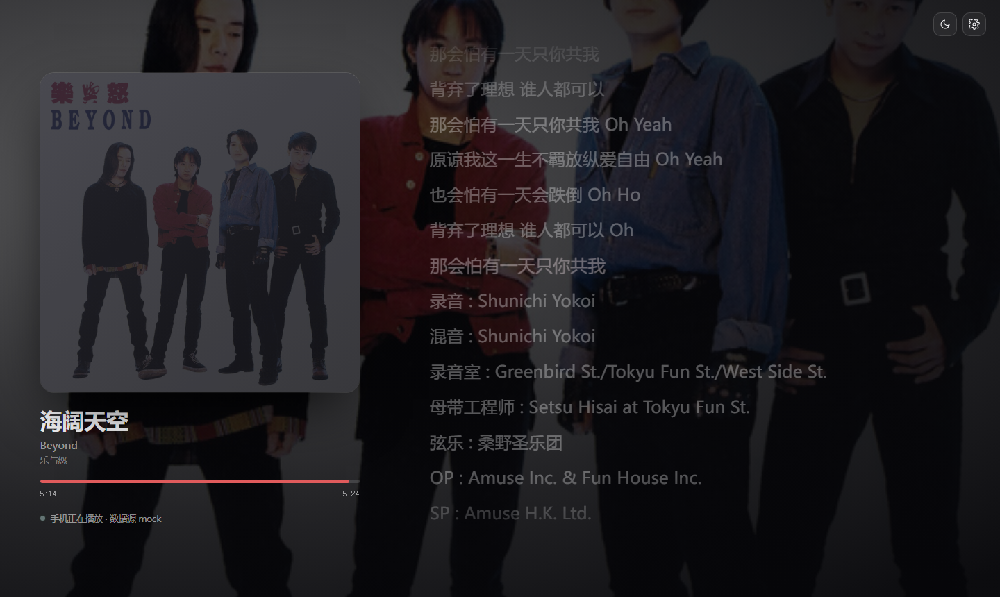
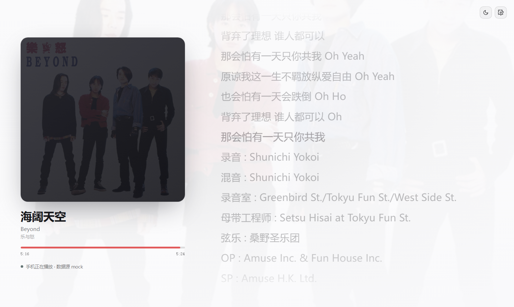

# NCM NowPlaying · 手机网易云 → 电脑实时歌词

**简体中文** | [English](README.en.md)

在安卓手机/平板上用网易云音乐放歌，电脑上实时显示**专辑封面 + 动态歌词 + 播放进度**。

两种显示方式，任选其一或同时用：

| 显示方式 | 说明 |
|---|---|
| **用 BetterLyrics 显示** | 把手机播放状态伪装成 Windows 媒体会话，BetterLyrics 自动识别并用自己的歌词引擎渲染（支持逐字歌词、辉光动效等全部特效）。见[方案 C](#方案-c用-betterlyrics或其它桌面歌词软件显示) |
| **用内置网页显示** | 本项目自带一个浏览器显示页，零配置，支持投到副屏/平板。见[接上真机](#接上真机) |

电脑端是一个 **零第三方依赖** 的 Node 服务（只要装了 Node 18+ 就能跑，不需要 `npm install`）。





---

## 它是怎么工作的

```
安卓手机（网易云音乐）
   └─ MediaSession 里带着 曲名 / 歌手 / 专辑 / 播放进度
        │
        ├─ 方案 A：无线 ADB 轮询 dumpsys media_session     ← 零安装，推荐
        └─ 方案 B：HTTP 推送到 /api/push                    ← 自建 App / Tasker / MacroDroid
             │
             ▼
      PC 桥接服务（Node）
        ├─ 解析播放状态，并按 speed/updated 外推得到「实时」进度
        ├─ 拿曲名+歌手去网易云接口匹配 → 拿封面、时间轴歌词（LRC）
        ├─ WebSocket 广播给浏览器
        └─ GET /api/nowplaying 对外提供精简状态
             │
             ├─────────────────────────┐
             ▼                         ▼
      浏览器显示页                 方案 C：SMTC 桥接
      http://localhost:8787       （smtc/smtc-bridge.ps1）
        ├─ 封面 + 模糊背景           把状态发布成 Windows 媒体会话
        ├─ 当前行高亮、平滑滚动       "NCMPhoneBridge"
        └─ 进度条、播放状态              │
                                         ▼
                                  BetterLyrics / 任何
                                  读取 SMTC 的桌面歌词软件
                                  （自带歌词引擎，支持逐字歌词）
```

几个设计上的取舍，值得说明：

- **封面和歌词不来自手机，来自网易云接口。** 手机端的 MediaSession 里通常没有封面位图，而它给的曲名+歌手足以在网易云搜到同一首歌，从而拿到高清封面和带时间轴的 LRC。这样歌词质量和端到端体验都明显更好。
- **进度是"外推"出来的，不是轮询出来的。** `dumpsys` 里的 `position` 只在 App 主动上报时刷新，直接读会一直卡住。所以解析时会记录 `position + speed + updated`（设备开机以来的毫秒数）三元组作为**锚点**，浏览器端再用本地时钟外推，配合一次 NTP 式的对时（`ping`/`pong` 估算时钟偏移），做到歌词逐行滚动在 60fps 下都很顺滑。
- **不依赖 `position` 字段的位置顺序，也不依赖 Bundle 的字段顺序。** `dumpsys` 把 metadata 打成 `description=A, B, C`，而 Bundle 的迭代顺序在不同 Android 版本上是不保证的——所以匹配器对每个字段都在**所有候选字符串里取最大值**，再叠加时长校验，而不是假设"第一个是歌名、第二个是歌手"。
- **WebSocket 是手写的。** 为了让项目零依赖，`src/ws.js` 里实现了 RFC6455 的握手、分片、掩码解码和 ping/pong。如果你更想用 `ws` 包，替换这一个文件即可。

---

## 快速开始

### 先看效果（不用手机）

1. 安装 [Node.js](https://nodejs.org/) 18 或更高版本
2. 双击 `demo.bat`

浏览器打开 <http://localhost:8787>，会看到一个虚拟播放列表在跑，封面和歌词都是真实的（走的是和真机完全相同的链路）。

### 接上真机

两条路，任选一条。

**① 手机 App（推荐，不用 adb）** —— 装了 `ncm-phone-bridge` 的话最省事：

| 步骤 | 做什么 |
|---|---|
| 1 | 手机 App 里点「启动服务」，记下屏幕上显示的地址 |
| 2 | 把地址填进 `config.json` 的 `phoneUrl`，双击 `start.bat` |

详细说明见[手机 App 直连](#最省事的用法手机-app-直连完全不用-adb)。

**② 无线 ADB** —— 不想在手机上装东西的话：

| 步骤 | 做什么 | 谁来做 |
|---|---|---|
| 1 | 手机开「开发者选项 → 无线调试」 | 你（只有你能操作） |
| 2 | 双击 `setup-adb.bat`，输入配对端口/配对码/调试端口 | 你输三个数，脚本负责其余 |

配对成功后，`setup-adb.bat` 会**自动**启动服务端和 SMTC 桥接（两个新窗口），不用再双击 `start.bat` 和 `smtc-bridge.bat`。

`setup-adb.bat` 会**实际读一次手机的播放状态并告诉你通没通**，不用自己猜。详细说明见[方案 A](#方案-a无线-adb手机无需装任何东西)。

不想开开发者选项的话，看[方案 B（HTTP 推送）](#方案-bhttp-推送不用开发者选项)。

---

## 最省事的用法：手机 App 直连（完全不用 adb）

如果你已经在手机装了 `ncm-phone-bridge`（本仓库隔壁那个 Kotlin 工程，编译产物是 APK），
推荐走这条：手机自己读播放状态、自己备好封面和歌词，电脑只负责显示。
整条链路里 **没有 adb，也不用在手机上开开发者选项**。

### 1. 手机侧

1. 安装 App，按引导开启「通知使用权」
2. 点「启动服务」，记下屏幕上的地址，形如 `http://192.168.1.23:8787`

### 2. 电脑侧

把地址填进 `config.json`：

```json
"phoneUrl": "http://192.168.1.23:8787"
```

然后双击 `start.bat`。启动日志会打印：

```
数据源：手机 App（http://192.168.1.23:8787）— 无需 adb
```

> 一旦填了 `phoneUrl`，服务就**不再启动 adb 轮询**（也就不会再出现"一直尝试重连手机"）。
> 想切回 adb 方式，把 `phoneUrl` 清空即可。

### 3. 平板 / 副屏

平板浏览器**直接打开手机那个地址**即可，数据不经过电脑：

```
http://192.168.1.23:8787
```

### 4. 想在电脑上用 BetterLyrics 显示

照旧双击 `smtc-bridge.bat`。它读的是本机 8787，而本机 8787 现在显示的正是手机 App 的内容，
所以 BetterLyrics 里会自动多出一个播放源 —— 见[方案 C](#方案-c用-betterlyrics或其它桌面歌词软件显示)。

### 数据是怎么对上的

电脑每 1.5 秒拉一次手机状态。手机给的进度时间戳用的是**手机自己的时钟**，
电脑会用请求往返的中点估算两台设备的时钟偏移、换算成本机时钟 ——
所以两台设备时钟哪怕差几分钟，歌词也照样对轨。

电脑端**不会重新匹配歌词**，直接用手机已经匹配好的结果（同一份数据同时供网页和 BetterLyrics 使用），
好处是两处显示永远一致，也不多花一次网络请求。

### 电脑自己在放歌（电脑当数据源）：为什么容易慢一拍

电脑这一侧是「去读别人的进度」，这里有个很容易被忽略的事实：**播放器不会每毫秒都刷新进度**。
网易云 PC 版大约每 1～2 秒才往 Windows 媒体会话（SMTC）里写一次新的 `Position`，
两次之间读到的值是冻住的 —— 实测**平均旧 0.96 秒、最坏 1.95 秒**。
把这样一个值当成「此刻的进度」，歌词就会稳定慢一拍，越靠近切歌点越明显。

时间轴上其实带着 `LastUpdatedTime`（这份进度是什么时候写进去的），所以：

1. `smtc/read-smtc-json.ps1` 读出 `Position` 后补上采样年龄，即
   `position = Position + (现在 − LastUpdatedTime)`（仅在播放中，且年龄不超过 3 秒时才敢补）；
2. 推送体里再带一个 `positionAgeMs`（采样到发出又过了多少毫秒），
   服务端收到后把锚点时间戳往回调同样的量。

锚点的语义因此始终是「`position` 这个进度值，是在 `serverTime` 这一刻成立的」——
前面 adb 源、手机端推送能对得准，用的都是同一条规则。

两个只依赖电脑、不依赖手机的量测工具（都是「用数字而不是感觉」）：

```bash
node tools/smtc-lag.js 24 250     # 播放器进度自己有多旧：原始值是一条 N 秒一格的阶梯
node tools/lag-check.js           # 端到端：页面用的进度 vs 播放器真实进度，误差中位数多少 ms
```

`lag-check.js` 里 `页面进度 − 真实进度` 的中位数在 ±120ms 以内就算对得准；
如果稳定是负几百毫秒，说明采样年龄没被补偿（先确认用的是不是改过之后的
`tools/smtc-push.js` 与 `src/hub.js`）。

> **改 PowerShell 脚本时注意**：`.ps1` 必须保持纯 ASCII（注释也写英文）。
> Windows PowerShell 5.1 在没有 BOM 时按 ANSI/GBK 读文件，一个 UTF-8 中文注释
> 解码后可能把**行尾换行吃掉**，于是下一行会被并进注释 —— 一行代码就这样静默消失，
> 不报任何错。这个坑本项目踩过一次（一个上限常量被吃掉，导致补偿逻辑永远不生效）。

---

## 方案 A：无线 ADB（手机无需装任何东西）

**一句话流程：手机开无线调试 → 双击 `setup-adb.bat`（配对成功后自动启动服务端和 SMTC 桥接）。**

手机和电脑要在同一个 Wi-Fi 下。

### 第 1 步 · 手机开启无线调试

1. 设置 → 关于手机 → 连续点 7 次「版本号」，提示「您已处于开发者模式」
2. 设置 → 系统 → 开发者选项 → 打开「**无线调试**」
3. 点进「无线调试」，选「**使用配对码配对设备**」，屏幕上会出现：
   - `IP 地址和端口`（例如 `192.168.1.23:37001`）← **配对端口**
   - `Wi-Fi 配对码`（6 位数字）
4. **别关这个对话框**，等下要把这两个数抄进去
5. 返回上一级，记下「无线调试」页面上那一行的 `IP 地址和端口`（例如 `192.168.1.23:5555`）
   ← **调试端口，和配对端口不是同一个数**

> 小米 / 红米还需要额外打开开发者选项里的「USB 调试（安全设置）」。
> 手机用 USB 连过一次电脑并授权过调试的话，可以跳过配对，直接在电脑上
> `adb tcpip 5555` 然后 `adb connect 手机IP:5555`。

### 第 2 步 · 电脑上运行引导

双击 `setup-adb.bat`（它会先自动下载 Google 官方 platform-tools，约 8 MB，只需一次），然后按提示输入：

```
配对端口（IP:端口）: 192.168.1.23:37001
6 位配对码: 123456
调试端口（IP:端口）: 192.168.1.23:5555
```

**它会真的去读一次手机的播放状态并告诉你结果**，而不是让你自己猜：

```
第 3 步 · 试读手机播放状态
──────────────────────────────────────────────
  解析出 2 个媒体会话：

  1. com.netease.cloudmusic  播放中
     元数据：起风了  |  冯沁苑(买辣椒也用券)  |  起风了
  2. com.example.video   paused

✓ 识别到网易云：起风了 - 冯沁苑(买辣椒也用券)
```

看到这个 ✓ 就说明整条链路通了。之后重新检查随时可以跑：

```bash
node tools\adb-setup.js --check
```

> 手机上先放一首歌再跑，结果最准。如果提示"没有曲目信息"，就照着它的提示
> 在手机上开始播放，然后重跑一次。

### 第 3 步 · 启动（自动）

配对成功后 `setup-adb.bat` 会自动拉起两个新窗口：

- **服务端**（`start.bat`）→ 浏览器打开 <http://localhost:8787> 看封面和歌词
- **SMTC 桥接**（`smtc-bridge.bat`）→ 用 BetterLyrics 显示

手机放歌，电脑上就会出现封面和歌词。如果之后只重开了服务（没重新配对），可以单独双击 `start.bat`；想只重开 BetterLyrics 桥接就双击 `smtc-bridge.bat`（见[方案 C](#方案-c用-betterlyrics或其它桌面歌词软件显示)）。

### 关于断线重连

无线调试在手机重启、切换 Wi-Fi 后会失效。`setup-adb.bat` 已经自动把地址写进了 `config.json`：

```json
"adbAutoConnect": "192.168.1.23:5555"
```

服务检测到设备掉线时会自动重连。如果手机 IP 变了（换了网络），重跑一次 `setup-adb.bat` 即可。

---

## 方案 B：HTTP 推送（不用开发者选项）

适合：不想开无线调试，或者想用 Tasker / MacroDroid 之类的自动化工具，或者你愿意自己写一个安卓小 App。

服务端只要收到这个请求就会更新显示：

```bash
# JSON POST
curl -X POST http://localhost:8787/api/push \
  -H "Content-Type: application/json" \
  -d '{"title":"海阔天空","artist":"Beyond","album":"乐与怒","duration":318000,"position":42000,"playing":true}'

# 或者 GET 简写（Tasker / MacroDroid 的 HTTP 请求动作直接拼 URL 最方便）
curl "http://localhost:8787/api/push?title=Lemon&artist=米津玄師&position=1000&playing=true"
```

| 字段 | 必填 | 说明 |
|---|---|---|
| `title` | 是 | 歌名 |
| `artist` | 否 | 歌手，**强烈建议提供**，缺了匹配准确率会下降 |
| `album` | 否 | 专辑名，进一步帮助匹配 |
| `duration` | 否 | 时长（毫秒），会作为匹配校验信号 |
| `position` | 否 | 当前进度（毫秒） |
| `playing` | 否 | 默认 `true`；传 `false` 表示暂停 |
| `cover` | 否 | 直接给封面 URL，会覆盖网易云匹配到的封面 |
| `songId` | 否 | 直接指定网易云歌曲 ID，**跳过搜索**，最可靠 |

> 想完全跳过匹配，就传 `songId`。歌曲 ID 是网易云链接里的那串数字，
> 例如 `https://music.163.com/#/song?id=1330348068` → `songId=1330348068`。

启动方式：双击 `start.bat` 前先把 `config.json` 里的 `"source"` 改成 `"push"`；
或者保持 `"auto"`——没有 adb 设备时它会自动改用推送通道。

---

## 方案 C：用 BetterLyrics（或其它桌面歌词软件）显示

[BetterLyrics](https://apps.microsoft.com/detail/9P1WCD1P597R) 是一款基于 WinUI3/Win2D 的桌面歌词软件，
支持逐字歌词、辉光动效、流体背景等一大堆特效，歌词源覆盖网易云/QQ/酷狗/LRCLIB。

**它不连手机，只监听 Windows 的系统媒体会话（SMTC）。** 所以我们需要把手机的播放状态"伪装"成一个本地媒体会话。

### 用法

1. 先按方案 A 或方案 B 把手机状态接进来（`start.bat` 要开着）
2. 双击 `smtc-bridge.bat`
3. 打开 BetterLyrics —— 它会在**几秒内自动识别**出一个新的播放源 `NCMPhoneBridge`

不需要在 BetterLyrics 里做任何配置（它的 `ListenOnNewPlaybackSource` 默认开启，新播放源会自动启用）。

### 它是怎么做到的

`smtc/smtc-bridge.ps1` 做的事：

1. 申请一个显式的 AppUserModelID，让媒体会话显示成 `NCMPhoneBridge` 而不是 `powershell.exe`
2. 创建一个 `MediaPlayer` 播放静音 WAV —— 这是**唯一能在不装任何东西的前提下注册出真实 SMTC 会话**的办法（Windows 没有给外部程序直接注册会话的接口，PowerShell 5.1 可以直接投影 WinRT 类型，所以整个桥接不需要编译器）
3. 轮询 `/api/nowplaying`，把 曲名/歌手/专辑/封面/时长/进度 镜像进去

### 两个非显然的坑（都已解决，记录一下）

**坑一：`MediaPlayer` 会持续用它自己的时间轴覆盖你手动设的。**
调用 `SystemMediaTransportControls.UpdateTimelineProperties()` 手动设进度，一秒内就会被播放器自己的时间轴（那个 2 秒静音文件）冲掉。跟它对抗是没用的。
解法是**让播放器自己的时间轴就是对的**：按歌曲真实时长生成对应长度的静音 WAV，然后直接 `seek` 播放器。这样播放器发布出去的时间轴天然就是正确的，不需要任何对抗。

**坑二：暂停中的 `MediaPlayer` 会忽略 seek。**
实测暂停状态下设置 `PlaybackSession.Position` 不生效，SMTC 报告的位置会一直停在暂停那一刻。
解法是**先 seek 再暂停**；暂停期间播放器不会刷新时间轴，此时手动写 `UpdateTimelineProperties` 就没有竞争了。

### 如果 BetterLyrics 显示的还是电脑上的歌

BetterLyrics 会在多个活跃播放源之间挑"当前聚焦"的那个。如果电脑上的网易云客户端也在放歌，
它可能选中 `cloudmusic.exe` 而不是 `NCMPhoneBridge`。

**解法**：在 BetterLyrics 设置 → 播放源里，把不想用的源（例如 `cloudmusic.exe`）关掉即可。

### 排查

```bash
node tools\list-smtc.js
```

列出当前所有 Windows 媒体会话，含曲名/歌手/封面的**实际字节数和格式**/时间轴。正常应该看到：

```
[1] session id : NCMPhoneBridge
    title        : 起风了
    artist       : 冯沁苑(买辣椒也用券)
    album        : 起风了
    cover        : yes, 389053 bytes, png
    position     : 254.4s / 326s
    playback     : Playing
```

- 列表里**没有** `NCMPhoneBridge` → 桥接没在跑，双击 `smtc-bridge.bat`。
- 有会话但 `cover` 是 `none` → BetterLyrics 只能靠自己的图片搜索补封面。
- 曲名是 `NCM Phone Bridge / waiting for phone playback` → 服务端当前没有曲目（先跑 `start.bat` 并确认 `node tools\adb-setup.js --check` 能读到歌）。

---

## 显示页怎么用

| 操作 | 说明 |
|---|---|
| 右上角月亮/太阳 | 切换明/暗主题（快捷键 `T`） |
| 右上角齿轮 | 打开设置（快捷键 `S`，`Esc` 关闭） |
| **底部控制条** | **上一首 / 播放暂停 / 下一首 / 收藏**（`←` `→` `空格` 也能用） |
| 拖「时间轴偏移」 | 歌词比声音快/慢时手动校准，`[` / `]` 每次微调 100ms |
| 「显示翻译」 | 开关外语歌词的中文翻译 |
| 「标题匹配」 | 自动匹配错了（比如电台、翻唱）时，搜正确曲目手动指过去 |
| `F` | 全屏，适合丢到副屏长期显示 |

### 控制条能干什么、不能干什么

- **切歌 / 播放暂停**：按当前音源自动选通道 ——
  电脑音源走 Windows 的 SMTC（网易云、QQ 音乐、Spotify、浏览器都行）；
  手机音源转发给手机 App 的 `/api/control`（App v1.4+，用通知使用权拿到的
  MediaController 下发）；adb 音源则直接注入媒体键（87/88/85，不需要 App 支持）。
  网页视频通常不支持「下一首」，会弹个提示。
- **手机推送模式下不用配 `phoneUrl`**：手机 App 主动推 `POST /api/push` 时，
  服务端会记住这条推送的来源 IP，切歌指令就发回那个地址。手机换了 IP 也不用改配置，
  下一次推送自动更新（`/api/state` 里的 `controlTarget` 能看到当前指向谁）。
  只有「电脑主动拉手机」的 `http` 源才需要 `phoneUrl`。
  区分两种 push 来源靠的是**来源地址是不是回环**：`127.0.0.1` = 本机 SMTC 发布端，
  局域网 IP = 手机。判错的后果就是「手机在放歌，点下一首却没反应」。
- **收藏（♥）**：加入 / 移出「我喜欢的音乐」。这是**账号侧**的操作，和音源无关，
  手机当音源时同样可用。第一次点会引导扫码登录。
- 控制条默认显示（半透明，不抢歌词），设置面板里可以整条关掉。

### 账号与隐私：到底哪里可能漏

收藏要先登录：设置面板 →「网易云账号」→「扫码登录」，用手机网易云 App 扫页面上的二维码，
不用输密码，也不用开发者选项。「退出登录」会删掉本机凭据文件。

**结论先说**：cookie 不会通过网络泄露。它只出现在「服务端 → `music.163.com` 的 HTTPS 请求」里，
不进页面、不进手机、不进日志。真正要防的是「**这台电脑上谁能读到那个文件**」。

| 风险 | 严重度 | 现在的处理 |
|---|---|---|
| 能读到 `.cache/netease-account.json` 的账户 / 程序 | **高** —— 文件里是 `MUSIC_U`，等于账号登录态 | 保存时自动 `icacls` 断掉 ACL 继承，只留当前用户（等价 POSIX `0600`） |
| 把 `.cache` 拷进网盘、或整个项目打包发给别人 | 高 | 发布的包只带 `prefs.json`；`tools/security-check.js` 会检查 zip 里有没有凭据 |
| 同一 Wi-Fi 下有人直接 curl 写接口 | 中 —— 能改「我喜欢」、切歌、改显示设置，**但拿不到账号** | 这是「扫码即用」的代价，取舍见下 |
| 你随手打开的某个网页偷偷调接口 | 中（CSRF） | 写接口加了来源校验：`Sec-Fetch-Site: cross-site`、陌生 `Origin`、表单编码请求体一律 403 |
| 局域网 ARP 嗅探 / 中间人 | 低 | 局域网里跑的只有歌名、封面、歌词这类公开数据，cookie 不经过它 |

为什么不做口令：一旦加密码，平板每次重开页面都要输一次，而它能挡住的只是「同一个 Wi-Fi 里的人」，
挡不住能读你磁盘的人。所以把力气花在凭据文件和打包物上，写接口只做到「不让网页偷偷调」。

**自查一条命令**：`node tools/security-check.js`

逐条报告：凭据文件在不在、ACL 是不是只有你能读、服务暴露到哪些地址、任何 GET 接口有没有把 cookie
吐出来、跨站请求是不是真的被挡住（最后一项会真发 4 个请求，但每一个都会在改数据之前被拒）。

**怀疑泄露时的止损顺序**：

1. 手机网易云 →「设置 → 账号与安全 → 登录设备管理」，踢掉网页 / 第三方会话；
2. 删掉 `.cache/netease-account.json`（或页面点「退出登录」）；
3. 改密码 —— 会让所有旧会话立即失效。

另外两点：

- 换电脑 / 同步网盘时**不要把 `.cache` 整个拷走**；
- 收藏走的是网易云网页端私有接口（个人使用的自动化），对方改接口时可能失效 ——
  失效只影响收藏按钮，歌词显示不受影响。

设置会**自动保存在服务端**（`.cache/prefs.json`），所以换 IP、换设备、换浏览器都不会丢 ——
只要连的还是同一个服务，打开就是你这套设置。

> 为什么不是只存浏览器：`localStorage` 是**按网址隔离**的，而这个环境里 IP 老是变，
> 一换 IP 浏览器就当成了新网站，设置全丢。所以同时存了一份在服务端。
> 设置面板底部还有「复制当前设置 / 粘贴恢复」，方便在**不同的服务端之间**迁移。

**URL 参数**（用于多屏投屏预设，只做临时覆盖，不写进存储）：

| 参数 | 示例 | 说明 |
|---|---|---|
| `theme` | `?theme=light` | 强制明/暗主题 |
| `size` | `?size=34` | 歌词字号（16–44） |
| `offset` | `?offset=-400` | 时间轴偏移（毫秒，-4000–4000） |
| `translation` | `?translation=0` | 关闭翻译歌词 |

例如挂到副屏做常驻歌词板：`http://192.168.1.10:8787/?theme=light&size=36&translation=0`

**多屏用法**：服务默认监听 `0.0.0.0`，启动时会打印局域网地址（形如 `http://192.168.1.10:8787`）。
在同一局域网的平板、副屏、电视浏览器里打开这个地址，就能当第二块歌词屏用。

**在平板上显示（手机或电脑播放都行）**：

1. 电脑双击 `start.bat`（启动服务端）
2. 平板连**和电脑同一个 Wi-Fi**
3. 平板浏览器打开 `http://<电脑局域网IP>:8787`（`start.bat` 窗口里有打印）

数据源可以是手机，也可以是电脑本身：

| 播放源 | 怎么做 |
|---|---|
| 手机 | 照常连无线调试（方案 A），平板自动显示手机在放的歌 |
| 电脑 | 再双击 `smtc-push.bat`，电脑上任何播放器（网易云 / QQ 音乐 / Spotify…）放的歌都会投到平板 |

两个源同时存在时**自动切换**：谁正在播放就显示谁，手机优先。比如电脑放歌时手机也点播放，平板会切到手机；手机一停又回到电脑。

**地址怎么拿（以及为什么二维码有时是错的）**

电脑的局域网 IP 会变（校园网 / 热点每连一次换一个），所以不要在平板上存死地址：

- `start.bat` 窗口里会打印所有可用地址，**第一行标着「推荐给平板 / 手机」**，并注明是哪张网卡；
- 电脑上打开显示页 → 设置面板的「投屏」里有当前地址 + 二维码，**每分钟自动刷新**，
  页面重新可见时也会立刻刷新 —— 避免挂了一整天的页面还显示旧 IP；
- 那一栏下面会把**所有候选地址**列成小胶囊，点一下就能换。装了 WSL / Hyper-V / Docker /
  VMware / VPN 的机器会有好几张虚拟网卡，它们也有 IP，但平板连不上 ——
  自动推荐不一定一次就对，手动换一个就好；
- 拿不准时跑一句体检：`node tools/lan-check.js`（列出每张网卡、判定物理/虚拟、给出推荐）；
- 想彻底钉死用某个地址：`config.json` 里填 `"lanHost": "192.168.1.42"`（启动参数 `--lan-host=...` 也行）。

> 如果**所有**地址都打不开，通常不是 IP 问题，而是防火墙没放行、两台设备不在同一网段，
> 或者校园网开了「客户端隔离」（AP isolation）—— 设备之间被禁止互访，这种网络下任何 IP 都没用，
> 只能让两台设备接到同一个手机热点。

---

## 配置项（config.json）

| 键 | 默认 | 说明 |
|---|---|---|
| `port` | `8787` | 监听端口 |
| `host` | `0.0.0.0` | 监听地址，只想本机访问就改 `127.0.0.1` |
| `source` | `auto` | `auto` / `adb` / `push` / `http` / `mock` |
| `adbPath` | `""` | 自定义 adb 路径，留空则自动在 `tools/` 和 PATH 里找 |
| `adbSerial` | `""` | 多设备时指定序列号 |
| `adbAutoConnect` | `""` | 形如 `192.168.1.23:5555`，掉线自动重连（带指数退避） |
| `phoneUrl` | `""` | **手机 App 的地址**，形如 `http://192.168.1.23:8787`。填了就改走 HTTP 源、不再启动 adb |
| `httpIntervalMs` | `1500` | 拉取手机状态的间隔（毫秒）。本来就是"读一次接口"，比 adb 轮询轻得多，所以可以快一些 |
| `pollIntervalMs` | `5000` | adb 轮询间隔（毫秒）。**建议保持 5000，别调小**：`dumpsys media_session` 是系统级 dump，对低端机不是零开销，太频繁可能给手机造成压力。歌词同步靠的是锚点外推而不是轮询频率，5 秒完全够顺滑。代码里还有一个 2000ms 的硬下限兜底 |
| `requirePackage` | `netease` | 只认这个包名的会话。改成 `""` 则接受任何播放器 |
| `lanHost` | `""` | 钉死投屏用哪个地址（自动判断在奇怪网络下失灵时的兜底）。留空则自动排序：物理网卡优先、命中系统出口地址优先、虚拟网卡垫底 |
| `translationEnabled` | `true` | 是否抓取并合并翻译歌词 |
| `coverSize` | `1024` | 封面边长。**它也作用于手机推送上来的封面**：图床原始地址不带尺寸参数时，部分专辑的原图可达 15MB（实测一张 14.9MB、下载 77 秒），必然超时。`1024` 约 1.2MB；调到 `500` 约 340KB，调到 `2048` 约 3.8MB（弱网下容易超时） |
| `lyricOffsetMs` | `0` | 服务端统一歌词偏移，一般用前端滑块调就够了 |
| `searchFallbackQueries` | `4` | 匹配时最多尝试几组搜索关键词 |

命令行也能临时覆盖：

```bash
node src/server.js --source=mock --port=9000
node src/server.js --serial=192.168.1.23:5555 --interval=600
node src/server.js --phone-url=http://192.168.1.23:8787   # 走手机 App，不用 adb
```

---

## HTTP 接口

| 接口 | 说明 |
|---|---|
| `GET /` | 显示页 |
| `GET /api/state` | 当前完整状态（曲目、歌词、播放锚点） |
| `GET /api/info` | 运行信息、配置、adb 状态、缓存统计 |
| `GET/POST /api/prefs` | **显示页的个性化设置**，存在服务端，换 IP / 换设备都不丢 |
| `GET /api/health` | 健康检查 |
| `GET /api/lan` | **本机可用地址列表**（按"平板连得上"的可能性排序，带网卡名与推荐标记），投屏二维码用它。可用 `lanHost` 钉死 |
| `POST /api/control` | `{action:"next"\|"prev"\|"toggle"\|"play"\|"pause"}`，向本机媒体会话发指令。仅当生效音源是 `push` 时可用 |
| `GET /api/account` | 网易云登录状态（只返回 `loggedIn` / 昵称，**不含 cookie**） |
| `POST /api/account/qr` | 生成扫码登录二维码 → `{key, url}`；`GET /api/account/qr?key=` 轮询（800 过期 / 801 待扫 / 802 待确认 / 803 成功） |
| `POST /api/account/logout` | 退出登录并删除本机凭据文件 |
| `POST /api/like` | `{songId, liked:true\|false}`，加入 / 移出「我喜欢的音乐」 |
| `POST/GET /api/push` | 上报播放状态（方案 B）。可选 `positionAgeMs`：这条 `position` 是多少毫秒之前采到的，服务端据此把锚点时间戳往回调 |
| `GET /api/search?q=关键词` | 搜索网易云曲目 |
| `POST /api/pin` `{songId}` | 手动指定当前曲目的正确 ID |
| `POST /api/refresh` | 清掉缓存重新匹配 |
| `GET /api/nowplaying` | **给外部集成用的精简状态**（曲名/歌手/封面/时长/实时进度），不含歌词数组，可高频轮询 |
| `GET /api/cover?url=...` | 封面代理（同源，前端才能提取主色；域名白名单只放行网易云图床） |
| `GET /api/debug/dumpsys` | **排错用**：返回最近一次原始 `dumpsys media_session` 输出 |
| `GET /api/debug/dumpsys?format=json` | 返回解析后的会话结构 |
| `WS /ws` | 状态推送；发 `{"type":"ping","t":<ms>}` 可对时 |

`/api/nowplaying` 的 `positionMs` 是**按锚点外推到请求时刻**的值，调用方不需要理解锚点机制，
拿来当作"此刻的播放位置"直接用即可。示例：

```json
{
  "ok": true, "active": true, "playing": true,
  "title": "起风了", "artist": "冯沁苑(买辣椒也用券)", "album": "起风了",
  "songId": 1330348068, "matched": true,
  "durationMs": 325868, "positionMs": 8634,
  "cover": "https://p3.music.126.net/.../109951163699673355.jpg?param=640y640"
}
```

---

## 排错

**先跑自检**

```bash
node test/selftest.js
```

它会不依赖手机地验证歌词解析、`dumpsys` 解析、匹配算法，并实际打网易云接口。22 项全绿说明服务端逻辑没问题，问题在网络或手机上。

**页面有问题时，查前端**

```bash
node test/ui-check.js                 # 检查默认页面
node test/ui-check.js "http://127.0.0.1:8787/?theme=light"
```

这个脚本会用本机已装的 Edge / Chrome 无头打开页面，通过 DevTools 协议读取**真实渲染结果**
（当前行不透明度、歌词滚动位移、封面是否加载、进度条数值、当前行是否落在 44% 位置），
并捕获所有 JS 运行时报错。改了 CSS 或前端逻辑之后跑一次，比肉眼看截图靠谱。

**页面显示「未检测到安卓设备」**

```bash
tools\platform-tools\adb.exe devices
```

- 显示为空 → 无线调试没连上。重新 `adb connect`。
- 显示 `unauthorized` → 在手机上确认弹出的调试授权。
- 显示 `offline` → `adb disconnect` 后重新 `connect`。

**页面显示「手机上当前没有正在播放的媒体」**

确认手机真的在放歌，且播放器**没有**被系统冻结。部分 ROM 会在息屏后限制后台，需要在系统设置里给网易云音乐开「允许后台运行」。

**平板扫二维码打不开（或提示无法访问）**

先跑体检，它会告诉你本机有哪些地址、哪张网卡是虚拟的：

```bash
node tools/lan-check.js
```

按可能性从高到低排查：

1. **IP 是虚拟网卡的** —— 装了 WSL / Hyper-V / Docker / VMware / VirtualBox / VPN 就会有额外的
   IPv4，平板连不上。显示页的二维码下方会把所有候选列成小胶囊，**点一下换成 WLAN 或以太网那个**。
   也可以跑 `node tools/lan-check.js` 看推荐项，或把 `config.json` 的 `lanHost` 填成正确地址。
2. **IP 变了** —— 校园网 / 热点每连一次换一个地址。页面上的地址和二维码现在每分钟自动刷新，
   长期挂着的页面也会在切回来时刷新；实在不行重开一次页面。
3. **防火墙** —— 首次运行 Node 会弹窗，必须选「专用网络」允许；不小心点了取消，
   去「Windows 安全中心 → 防火墙和网络保护 → 允许应用通过防火墙」里把 Node.js 勾上。
4. **不在同一网段** —— 一个连 5G、一个连 2.4G，或者一个连访客网络，都可能被划到不同 VLAN。
5. **客户端隔离（AP isolation）** —— 校园网 / 酒店 Wi-Fi 常见，设备之间被禁止互访。
   这种情况下**任何 IP 都没用**，验证方法：两台设备都连手机热点再试一次，能通就是它。

**曲名对了但歌词匹配错了**

设置面板里搜正确的曲目点一下即可；或者直接 `POST /api/push` 带 `songId`。

**完全匹配不上，页面显示「未匹配到网易云曲目」**

电台、播客、本地文件本来就没有对应的网易云单曲。可以打开 `config.json` 的 `"logRawDumpsys": true`，重启后访问 `/api/debug/dumpsys` 看看到底拿到了什么，再判断是解析问题还是确实无对应曲目。

**歌词整体快/慢半拍**

先量一下是多少毫秒，别凭感觉调：

```bash
node tools/lag-check.js          # 页面进度 vs 真实进度，给中位数和最坏值
node tools/smtc-lag.js 24 250    # 播放器自己的进度有多旧（阶梯 + 采样年龄）
```

- **稳定慢几百毫秒到 2 秒**（电脑当数据源时最常见）：播放器刷新媒体会话进度的间隔就是这么大。
  确认 `smtc/read-smtc-json.ps1`、`tools/smtc-push.js`、`src/hub.js` 都是带 `positionAgeMs`
  补偿的版本，然后重启服务端和推送窗口。
- **稳定快/慢一个固定小量，且各设备一致**：拖动设置里的「时间轴偏移」按 200ms 微调。
  这通常是歌词时间轴本身与音源有几拍差异，属于正常现象。
- **只有平板慢、电脑上正常**：那是对时问题，不是数据源问题。

---

## 已知限制

- **切歌 / 播放暂停在三种音源下都可用，但通道不同。** 电脑音源走 SMTC；
  手机 App 音源转发给 App 的 `/api/control`（**需要 App v1.4+**）；
  adb 音源往手机注入媒体键（不需要 App，但无法确认播放器是否真的执行了）。
  adb 注入依赖 `input keyevent`，个别 ROM 会拦，失败时会提示。
- **网页要跑在电脑上才能同时有「切歌 + 收藏」。** 手机 App 自带的那张页面
  （平板直连手机 `http://手机IP:8787`）只有歌词，没有控制条，也没有账号模块。
  平板打开**电脑的**地址，才能拿到上一首 / 下一首 / 播放暂停 / 红心四个按钮 ——
  哪怕歌是手机在放，切歌指令也会被电脑转回手机。
- **收藏需要登录，且依赖网易云网页端私有接口。** 登录后 cookie 存在本机 `.cache/netease-account.json`；
  接口属于非官方用法，对方调整时收藏可能失效（歌词显示不受影响）。未匹配到网易云 ID 的曲目无法收藏。
- **内置网页没有逐字（卡拉OK）歌词。** 网易云的逐字歌词走私有 YRC 格式，普通 `/api/song/lyric` 接口目前拿不到（代码里已经写好了 YRC 解析器，一旦接口返回就自动启用）。现在是**逐行**高亮。想要逐字效果请走[方案 C](#方案-c用-betterlyrics或其它桌面歌词软件显示)，用 BetterLyrics 自己的歌词引擎。
- **方案 C 里 BetterLyrics 拿到的是曲名+歌手，没有曲目 ID**（`Song ID` 为空），所以它靠自己的模糊搜索匹配歌词。电脑版网易云会通过 `genres` 字段把曲目 ID 传给 BetterLyrics，我们的桥接没有走这条路——因为那要求把会话 ID 伪装成 `cloudmusic.exe`，会和电脑上真实的网易云客户端撞车。匹配错了在 BetterLyrics 里手动指定一次即可。
- **只有你手动 `pin` 过的曲目才跳过搜索**，其余都靠曲名+歌手模糊匹配，冷门翻唱偶尔会匹配到同名歌曲。
- **依赖网易云公开接口**，属于非官方用法，可能因为对方调整风控而失效。解析器带缓存和降级（拿不到歌词时仍显示封面和曲名），不会因此卡死。
- `dumpsys` 输出格式各厂商 ROM 有差异。解析器按「就近归属」而不是缩进层级来解析，兼容性已经尽量做宽，但如果你的机型拿不到元数据，用 `/api/debug/dumpsys` 把原始输出发我，加一条适配规则就行。
- **方案 C 的桥接窗口必须开着**，关掉后 `NCMPhoneBridge` 会话会消失（BetterLyrics 会回落到其它播放源）。

## 参考

同类开源项目，可对照思路：

- [Aoi-hosizora/NcmlAtw](https://github.com/Aoi-hosizora/NcmlAtw) — .NET + 自建安卓 App，思路一致但已停更
- [dUwUb2004/LyricSync](https://github.com/dUwUb2004/LyricSync) — 走 adb logcat 取数据，仍在开发中
- [jayfunc/BetterLyrics](https://github.com/jayfunc/BetterLyrics) — 本项目的方案 C 就是为接入它而做的；它的 `MediaSourceProvidersInfo`（按播放器进程名分别配置）和 `PlayerIdHelper` 是理解 SMTC 接入方式的关键

本项目的差异点：零依赖、无线 ADB 直接读 MediaSession（不需要装 App）、基于 `position/speed/updated` 的进度外推，以及把手机播放状态投射成 Windows 媒体会话从而复用现成的桌面歌词软件。
